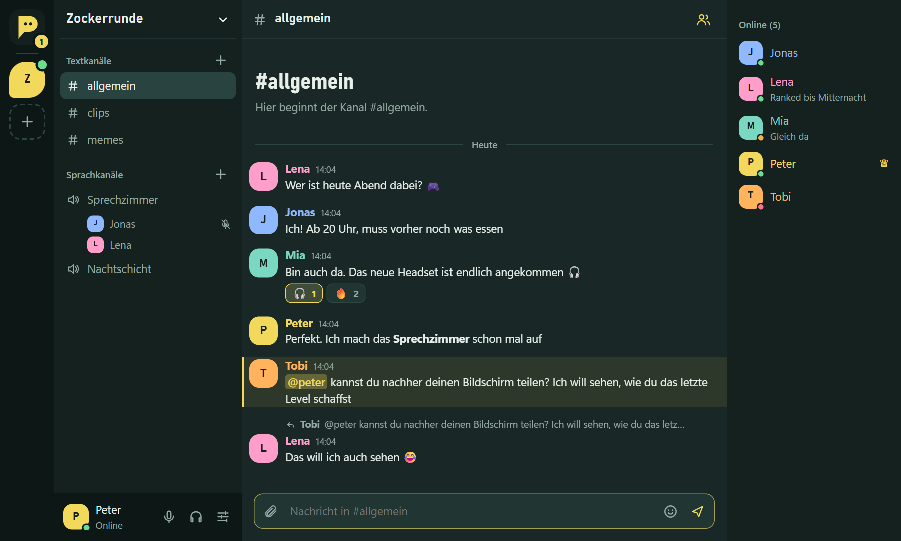

# PeterCord

Chat für uns: Direktnachrichten, Gruppen mit Text- und Sprachkanälen, Anrufe und Bildschirm teilen.
PeterCord ist bewusst schlank gebaut: Der Installer ist rund 2 MB groß, und im Hintergrund braucht die App nur etwa
150 MB Arbeitsspeicher und praktisch keine Rechenleistung.

## Installieren (Windows 10 und 11)

1. Öffne die Seite mit der [neuesten Version](https://github.com/IchPity/PeterCord/releases/latest).
2. Lade unter **Assets** die Datei herunter, die auf `_x64-setup.exe` endet.
3. Starte die Datei. Windows zeigt beim ersten Mal „Der Computer wurde durch Windows geschützt“.
   Klicke auf **Weitere Informationen** und dann auf **Trotzdem ausführen**.
   (Die Meldung erscheint, weil PeterCord kein gekauftes Zertifikat hat – nicht, weil etwas nicht stimmt.)
4. Klick dich durch den Installer. Administratorrechte braucht er nicht.
5. PeterCord startet. Wähle **Neu hier? Konto erstellen**, such dir einen Benutzernamen und ein Passwort aus – fertig.

Merk dir dein Passwort gut: Es gibt keine E-Mail-Adresse, über die du es selbst zurücksetzen könntest.
Wenn du es doch vergisst, kann Peter dir ein neues setzen.

## Erste Schritte

**Freunde hinzufügen:** Unter *Freunde* den Benutzernamen eingeben und *Anfrage senden* drücken.
Sobald die Anfrage angenommen ist, könnt ihr euch schreiben und anrufen.

**Gruppe gründen oder beitreten:** Das Plus in der linken Leiste öffnet beides. Wer eine Gruppe erstellt,
findet den Einladungscode im Menü der Gruppe (Klick auf den Gruppennamen → *Freunde einladen*).
Wer den Code bekommen hat, gibt ihn unter *Einer Gruppe beitreten* ein.

**Sprechen:** In einer Gruppe auf einen Sprachkanal klicken, in einer Direktnachricht auf den Hörer oben rechts.
Beim ersten Mal fragt PeterCord, ob es dein Mikrofon benutzen darf – erlaube das.
Mit dem Bildschirm-Symbol teilst du deinen Bildschirm, ein Klick auf eine Person im Sprachkanal regelt ihre Lautstärke.

**Nachrichten:** `Enter` sendet, `Umschalt + Enter` macht eine neue Zeile. Bilder und Dateien (bis 10 MB) kannst du
anhängen, hineinziehen oder aus der Zwischenablage einfügen. Fahr mit der Maus über eine Nachricht, um zu
reagieren, zu antworten, sie zu bearbeiten oder zu löschen. Mit `@benutzername` erwähnst du jemanden.
`**fett**`, `*kursiv*`, `~~durchgestrichen~~` und `` `Code` `` funktionieren auch.

## Updates

PeterCord hält sich selbst aktuell. Bei jedem Start schaut die App nach, ob es eine neue Version gibt, und
installiert sie sofort – das dauert ein paar Sekunden. Läuft die App schon länger, erscheint oben ein Hinweis mit
dem Knopf **Jetzt aktualisieren**. Du musst nie wieder etwas herunterladen.

## Gut zu wissen

- **Das Kreuz schließt nur das Fenster.** PeterCord läuft im Infobereich neben der Uhr weiter und meldet neue
  Nachrichten. Ein roter Punkt am Symbol heißt: Da ist etwas Ungelesenes. Ganz beenden: Rechtsklick auf das Symbol → *Beenden*.
- **Mit Windows starten:** *Einstellungen* (Regler-Symbol unten links) → *App* → Häkchen setzen.
- **Aussehen anpassen:** *Einstellungen* → *Darstellung*: Farbschema (auch hell oder wie Windows), Akzentfarbe,
  Schriftgröße und Abstand der Nachrichten, Ecken und Animationen.
- **Ruhe haben:** Klick unten links auf deinen Namen und stell den Status auf *Nicht stören* – dann bleibt alles still.
- **Ohne Installation:** PeterCord läuft auch im Browser unter <https://petercord.hakwt.workers.dev>, zum Beispiel am Handy.
- **Deinstallieren:** Windows-Einstellungen → Apps → PeterCord → Deinstallieren.

## Wenn etwas nicht klappt

| Problem | Lösung |
| --- | --- |
| Niemand hört mich | Mikrofon-Anfrage aus Versehen abgelehnt? Unter *Einstellungen → Sprache & Video* auf *Mikrofonzugriff erlauben* klicken. Hilft das nicht: Windows-Einstellungen → Datenschutz und Sicherheit → Mikrofon: Zugriff für Desktop-Apps erlauben. Und in PeterCord das richtige Mikrofon wählen. |
| Ich höre niemanden | Unter *Einstellungen → Sprache* den richtigen Lautsprecher wählen und prüfen, ob das Kopfhörer-Symbol unten links durchgestrichen ist. |
| Der Anruf verbindet nicht | Sprache läuft direkt von Gerät zu Gerät. In manchen Firmen-, Schul- oder Mobilfunknetzen wird das blockiert – probier ein anderes Netz. |
| „Keine Verbindung zum Server“ | Internetverbindung prüfen. PeterCord verbindet sich von selbst wieder. |
| Passwort vergessen | Peter Bescheid geben, er setzt dir ein neues. |

---

Du willst an PeterCord mitbauen oder selbst einen Server betreiben? Alles dazu steht in [ENTWICKLUNG.md](ENTWICKLUNG.md).
